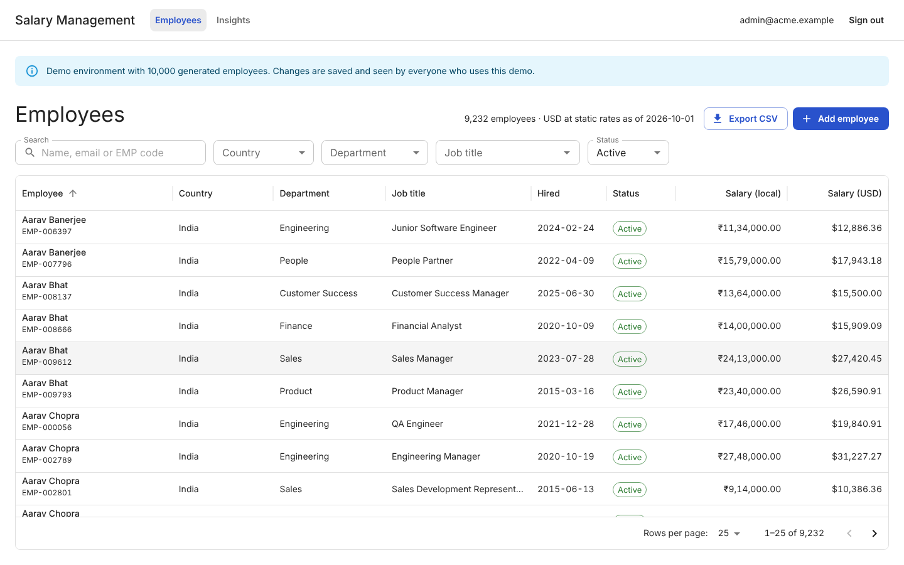
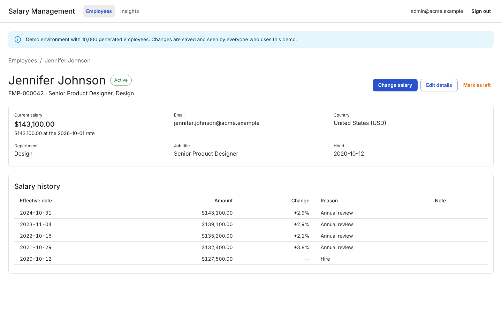
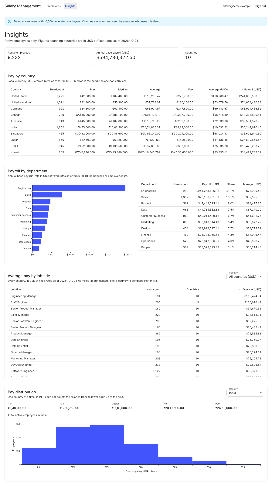

# Salary Management

A web app for ACME's HR manager to manage salaries for 10,000 employees across countries,
and to answer "how do we pay people?". This is a take-home assessment for Incubyte.

> **Live:** https://salary-management-topaz.vercel.app. Demo login: `admin@acme.example` /
> `Password@123`, published on purpose for reviewers. Changes are saved and shared by
> everyone using the demo, and re-running the seed restores the starting data.
>
> **Video:** [a 2:39 walkthrough](https://drive.google.com/file/d/1YPJtjKCh5Z_a4nAyP_f97pENJ1pX6tB2/view?usp=sharing)
> of the directory, the export, employee records and Insights, with captions instead of a
> voice-over. [docs/demo-script.md](docs/demo-script.md) says how it was made.

## What it does

- **Directory** of 10,000 employees in 10 countries: search by name, email or code, filter
  by country, department, job title and status, sort on any column, page on the server.
  Filters live in the URL.
- **Employee records:** add someone with a starting salary, edit their details, record a
  salary change with its date and reason, mark them as left. Salary history is
  append-only, and a leaver's record becomes read-only.
- **Insights** for active employees: min, median, average and max by country in local
  currency; average pay by job title, across countries in USD or within one country;
  payroll by department; a pay distribution with P10–P90 per country.
- **CSV export** of the filtered directory that Excel opens correctly.
- Money is stored as integers in each currency's minor unit; USD figures use one static
  rate snapshot and say so.

| Directory | Employee | Insights |
|---|---|---|
| [](docs/images/directory.png) | [](docs/images/employee.png) | [](docs/images/insights.png) |

## Run it locally

You need Node 22.22.2 or later on the 22.x line (see `.nvmrc`).

```sh
npm ci
npm run dev      # API on http://localhost:3000, web app on http://localhost:5173
npm run verify   # lint, type-check and every test
```

Locally, sign in as `admin@acme.example` with the password `local-demo-password`, a
local-only default. Set `ADMIN_EMAIL` and `ADMIN_PASSWORD` to use your own.

Other scripts:
- `npm test -- --project web` runs one workspace's tests.
- `npm run seed -- --reset` rebuilds the local database with the 10,000 employees.
- `npm run measure` times the running app (set `BASE_URL` for another site); see
  [docs/performance.md](docs/performance.md).
- `npm run build` builds the web app.
- `npm start` runs the API alone.
- `node scripts/deploy-smoke.mjs` builds the repo with Vercel's CLI and boots the result,
  as CI does.

## Read this first

| What the brief asks for | Where it is |
|---|---|
| Requirements document (one page) | [docs/requirements.md](docs/requirements.md) |
| Clarifying questions and assumptions | [docs/clarifications.md](docs/clarifications.md) |
| Planning and design notes | [docs/plan.md](docs/plan.md) |
| Architecture diagrams, data model, API | [docs/architecture.md](docs/architecture.md) |
| Design system (components, tokens, motion) | [docs/design-system.md](docs/design-system.md) |
| How changes reach `main` | [CONTRIBUTING.md](CONTRIBUTING.md) |
| Trade-offs and decisions | [docs/decisions.md](docs/decisions.md) |
| Performance considerations | [docs/architecture.md §11](docs/architecture.md#11-performance-considerations), measured numbers in [docs/performance.md](docs/performance.md) |
| Demo video: how it was made, and its script | [docs/demo-script.md](docs/demo-script.md) |
| AI prompts and workflow | [docs/ai/](docs/ai/README.md), [CLAUDE.md](CLAUDE.md) |

## Tests

408 tests run in CI on every pull request (`npm run verify`): 94 in `shared`, 240 in
`api`, 74 in `web`. Coverage is 96% of statements and 85% of branches
(`npx vitest run --coverage`); it is reported, not enforced.

- Domain and API behaviour were written test first: each feature has a `test:` commit
  that fails, then the `feat:` commit that makes it pass.
- API tests run every route through the real app on a fresh in-memory database with the
  real migrations. The clock is injected, so date rules are deterministic.
- The suite takes about 45 s, over the plan's 10 s target, mostly from rendering the Data
  Grid, dialogs and charts in jsdom ([plan](docs/plan.md#test-strategy)).

## Stack

- **API:** Node 22, TypeScript, Express 5, SQLite through libSQL (`@libsql/client`).
- **Web:** React 19, Vite, MUI (Material UI, X Data Grid, X Charts, X Date Pickers),
  TanStack Router and Query.
- **Tests:** Vitest.
- **Hosting:** one Vercel project on the free Hobby plan, with two services
  ([vercel.json](vercel.json)): the web app on `/` and the API on `/api`. Data lives in
  Turso's free hosted SQLite, so it persists.

## Deploy it

The owner does this once. The reasons are in [architecture §10](docs/architecture.md#10-deployment).

1. **Vercel:** import the GitHub repo as a new project. Leave the root directory at the
   repository root. The framework preset should read "Services", detected from
   `vercel.json`.
2. **Turso** (needed from slice S4): create two databases in `aws-us-east-1`, next to
   Vercel's default function region, one for production and one for previews. Create a
   token for each.
3. **Vercel → Settings → Environment Variables:** set `TURSO_DATABASE_URL` and
   `TURSO_AUTH_TOKEN` for Production (production database) and for Preview (preview
   database), and `ADMIN_EMAIL` and `ADMIN_PASSWORD` for both: the HR login. A deployment
   without them refuses to start. Optionally set `APP_TIME_ZONE` (an IANA name such as
   `Europe/London`) to decide what "today" is for date rules; it defaults to
   `Asia/Kolkata`.
4. **GitHub → Settings → Secrets and variables → Actions:** add four repository secrets,
   `TURSO_PREVIEW_DATABASE_URL`, `TURSO_PREVIEW_AUTH_TOKEN`,
   `TURSO_PRODUCTION_DATABASE_URL` and `TURSO_PRODUCTION_AUTH_TOKEN`. For the Performance
   workflow, also add `ADMIN_EMAIL` and `ADMIN_PASSWORD`, the same values as in Vercel.
5. **Actions → Database → Run workflow:** run `check`, then `seed`, once for each database.
   `seed` replaces all employees with the 10,000 seeded ones, so it also resets the demo.
6. **Actions → Performance → Run workflow** (optional): times the deployed app and writes
   the table to the run's summary.

Every change goes through its own branch and a pull request into `main`; nobody pushes to
`main` directly. See [CONTRIBUTING.md](CONTRIBUTING.md).

The reasons for each choice are in [docs/decisions.md](docs/decisions.md).
