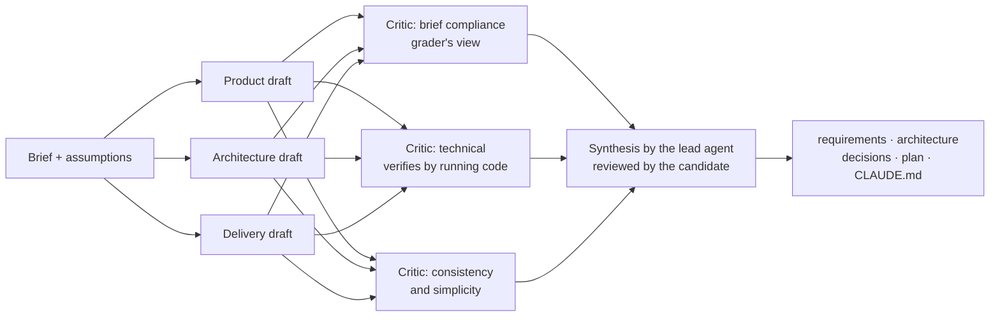

# How AI is used on this project

The brief asks candidates to use AI tools deliberately. This page describes how, and
where the human stays in control.

## Tools

- **Claude Code**, run as a cloud session against this repository. It is the coding agent
  and planning partner.
- **Multi-agent workflows** inside Claude Code. For bigger thinking tasks, several agents
  work independently and others then review their work adversarially.

## Principles

1. **The human owns decisions.** Agents draft and critique options and propose each
   decision. The candidate reviews them, overrides where they disagree, and is accountable
   for the result. Reasons are recorded in [decisions.md](../decisions.md), and the
   candidate's review is recorded in [prompts/01-conversation.md](prompts/01-conversation.md).
2. **Claims get checked, not trusted.** A critic agent checked technical claims by
   running probes against the exact package versions: SQLite behaviour, Express 5
   semantics, scrypt limits, TypeScript 7 compatibility. These are marked *(verified)* in
   the decision log, and the ones the design depends on become tests.
3. **Tests are the spec.** For domain and API behaviour, the failing test is written and
   reviewed before any implementation. Small diffs, read in full.
4. **Mistakes are logged, not hidden.** [log.md](log.md) records what AI got wrong and
   what caught it.
5. **AI involvement is visible in git.** Commits made through the agent are attributed
   to Claude.

## Planning workflow (14 Oct 2026)

- **Drafters worked independently,** each through one lens, so their disagreements came to
  the surface instead of being smoothed over. The architecture and delivery drafters ran
  experiments in a scratch folder, e.g. benchmarking 10k-row queries and checking
  package compatibility.
- **Critics were told to refute, not to agree.** The technical critic installed the exact
  package versions and tried each claim.
- **Size:** 6 agents, about 38 minutes, about 760k tokens. The prompts are in
  [prompts/](prompts/).

### What the critique changed

| Before critique | After |
|---|---|
| Relocation was a Should in one draft, half-built in another, out of scope in the third | Out of scope in v1, with reasons (X2) |
| Medians in SQL (one draft) vs in TypeScript (two drafts) | SQL for plain aggregates, TypeScript for percentiles, matching Excel (D10) |
| Layered build order: first demoable result on day 3 | Vertical slices: deployed on day 1, demoable mid day 2 (plan.md) |
| Insights endpoints exposing filters and fields no screen uses | Trimmed to what the UI renders |

Factual errors the critics caught are listed in [log.md](log.md). A second review round
then checked the written docs for contradictions, technical errors and readability.

## Build loop (from slice S1 onward)

Each behaviour from [plan.md](../plan.md) goes: red test, reviewed by the candidate as the
spec; then green; then refactor. The rules are in [CLAUDE.md](../../CLAUDE.md). Surprises
go into [log.md](log.md).
