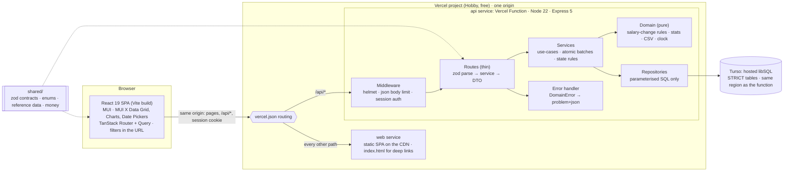
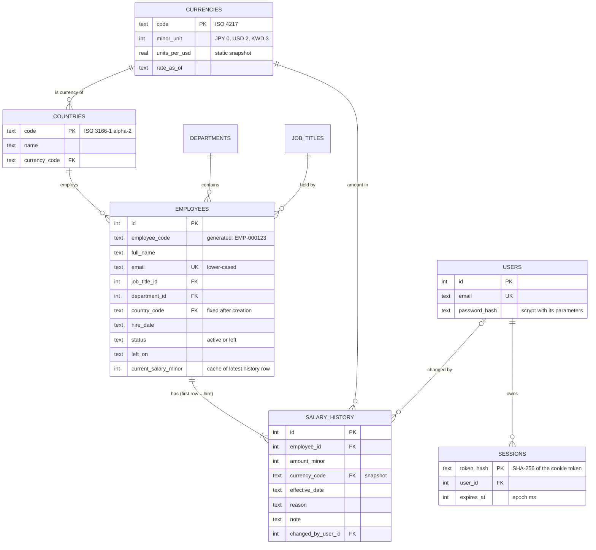

# Architecture

This document covers how v1 is built. The reasons behind each choice are in
[decisions.md](decisions.md), and the scope is in [requirements.md](requirements.md).

## 1. System overview

One Vercel project with two services, served from one origin. `vercel.json` sends `/api/*`
to the `api` service, the Express app running as a Vercel Function, and every other path
to the `web` service, the static React build. Data lives in Turso, a hosted SQLite
(libSQL) database in the same AWS region as the function. Locally the API is a plain Node
process using a SQLite file, and tests use an in-memory database (§10).



**Why one Vercel project:** the UI and the API deploy together from the same commit, so
they can't drift apart, and every pull request gets a full preview. The browser sees one
origin: no CORS, and the cookie story stays simple (§9). A function has no minute-long
wake like a sleeping free server, so the app needs no "waking the server" screen.

**Why Turso:** a function has no lasting disk, so the data must live elsewhere. Turso is
SQLite over the network. It keeps the same SQL and STRICT tables, and the same client
(`@libsql/client`) also opens a local file or an in-memory database, so tests run the real
migrations without a network. Data persists across deploys and idle time.

## 2. Repository layout

npm workspaces, three packages:

```
vercel.json               the two Vercel services and the routing between them
api/      @salary/api     Express API, seed script; runs .ts directly on Node 22 locally
  src/
    main.ts               local server: config → prepare the database → listen
    vercel.ts             Vercel entry point: default-exports the app
    app.ts                buildApp(deps): the Express app, no listen(); used by tests
    config.ts             env vars validated with zod
    http/                 error handler, requireAuth
    db/                   client, migration runner, migrations/*.ts, reference sync, db:check
    domain/               pure functions: salary-change rules, stats, csv, clock
    auth/ employees/ insights/ export/
                          feature folders: routes.ts, service.ts, repository.ts (+ tests)
    seed/                 prng, catalogue, generate (pure), write, cli
web/      @salary/web     React + Vite + MUI (Material UI, X Data Grid, X Charts, X Date Pickers)
  src/                    routes, features/{auth,employees,insights}, theme/, api client & hooks
shared/   @salary/shared  imported as TypeScript source by both api and web, no build
  src/                    zod contracts, enums, countries/currencies/FX snapshot, money
scripts/                  deploy-smoke.mjs, run by CI (§10)
docs/                     requirements, decisions, architecture, design system, plan, ai/
```

## 3. Layering rules

- **Routes** handle HTTP only. They parse input with a shared zod schema, call one service
  method and map the result to a DTO. They contain no SQL and no business rules.
- **Services** own each use-case. A use-case sends its writes as one
  `db.batch([...], 'write')`, which libSQL runs as a single transaction: if a statement
  fails, none of them commit *(verified on a local libSQL file)*. Services enforce rules that depend on stored data:
  the employee is active, the effective date is not before the latest change, and
  referenced ids exist. They throw typed `DomainError`s and know nothing about HTTP.
- **Domain** code is pure: no I/O, no framework imports. The clock and the random number
  generator are injected. This is where most unit tests live.
- **Repositories** hold the SQL, always parameterised. They map rows to camelCase objects.
  They translate SQLite unique-constraint errors into `ConflictError`, and a trigger's
  named `RAISE` error into the matching `DomainError`. The mapping matches
  `code === 'SQLITE_CONSTRAINT'` plus the constraint or `RAISE` name in the message. Over
  Turso's HTTP protocol the client leaves `extendedCode` empty and prefixes the message
  with "SQLite error:" *(verified in the client and server source)*, so extended codes and
  exact messages can't be relied on. A unit test feeds the mapper both shapes.
- **Numbers bind as REAL.** The libSQL client sends every JavaScript number as REAL, even
  whole ones *(verified)*. STRICT INTEGER columns still store integers, but arithmetic on
  a parameter is float arithmetic: `7 / ?` with 2 gives 3.5. So SQL never does integer
  maths on parameters; that happens in TypeScript (D10).
- **Dependencies are wired by hand** with factory functions; there is no DI container.
- **No interactive transactions** (decision D17). Function instances run side by side, so
  another request can write between a service's check and its batch. So a rule that
  depends on stored data is checked twice:
  - by the service first, for a clear error;
  - by the database inside the batch, through a CHECK or a trigger that raises, so the
    whole batch rolls back. For example, a trigger rejects a salary-history row for an
    employee who has left, or one dated before the employee's latest change. A guarded
    `WHERE` is not enough: a statement that matches no rows doesn't fail, so the rest of
    the batch still commits *(verified)*.

  Turso's single primary queues write batches, so concurrent requests cannot corrupt
  data. Locally, one process runs its batches one after another; a second process on the
  same file (a seed run during `npm run dev`) waits because file URLs open with a 5 s
  `timeout`, instead of failing at once with `SQLITE_BUSY`. S4 checks concurrent writers
  on a real Turso database. None of this prevents a lost update from a stale form, such
  as two open tabs editing the same employee, where the last save wins. With a single HR
  user that is accepted in v1, so there is no optimistic locking.

Validation happens in three layers:
1. **zod at the HTTP edge:** shape, types, ranges, real dates, and `.strict()` request
   objects, so unknown fields are rejected. Response contracts in `shared/` are not
   strict: an open tab can be older than the API (§10), so fields a newer API adds are
   stripped rather than rejected.
2. **Services:** rules that depend on stored state.
3. **Database:** STRICT types, NOT NULL, CHECK, UNIQUE, foreign keys and triggers, as the
   last line of defence.

## 4. Data model

The migration in `api/src/db/migrations/` is the source of truth for the schema. This
section records the design and the constraints that matter.



`departments` and `job_titles` are plain `(id, name)` lists, with names unique regardless
of case. `schema_migrations(version)` records the applied migrations (D2). All tables are
`STRICT`.

The single place where USD conversion is defined:

```sql
CREATE VIEW employee_salaries AS
SELECT e.*,
       co.currency_code,
       cu.minor_unit,
       e.current_salary_minor
         / ((CASE cu.minor_unit WHEN 0 THEN 1.0 WHEN 2 THEN 100.0 ELSE 1000.0 END)
            * cu.units_per_usd) AS salary_usd
FROM employees e
JOIN countries  co ON co.code = e.country_code
JOIN currencies cu ON cu.code = co.currency_code;
```

The view divides by a `CASE` on the minor unit (0, 2 or 3, enforced by a CHECK) rather
than `power(10, minor_unit)`, so it needs no math extension on Turso. *Changed in S4.*

Every CHECK is written to be NULL-proof, because a CHECK that evaluates to NULL passes:
`IS date(col)` for dates, and `coalesce(length(trim(note)), 0) > 0` for the note an
`other` reason requires. A test caught the plain `length(trim(note)) > 0` letting a
missing note through.

Indexes are added when a measured query needs them, and each is recorded in the
performance notes. The starting set covers foreign-key lookups, `(country_code, status)`
and the default sort `(full_name COLLATE NOCASE, id)`.

Constraints that matter:
- **Positive amounts.** `current_salary_minor > 0` and `amount_minor > 0`. Status and
  `left_on` must agree: `(status = 'left') = (left_on IS NOT NULL)`, and
  `left_on >= hire_date`. The reason is checked against the fixed list.
- **Date checks use `IS date(col)`, not `= date(col)`.** For malformed input such as
  `'banana'`, `date()` returns NULL, and a CHECK that evaluates to NULL passes. A repository
  test inserts a bad date and expects the constraint to fail.
- **Current salary is a cached column** kept next to the history (decision D5). The salary
  change and the history row are written in the same batch. Effective dates must be on or
  after the latest change and no later than today, so the cache can never go stale. A
  trigger enforces the ordering inside the batch, so concurrent changes can't break it
  (D17).
- **There is no currency column on `employees`.** Currency is derived from the country,
  and country cannot change in v1. Each history row stores its own currency as a snapshot.

## 5. Money and exchange rates

- **Storage.** Money is always an integer in the currency's minor unit plus an ISO 4217
  code. INR 25,00,000.00 is stored as `250000000`. JPY 8,000,000 is stored as `8000000`,
  because JPY has no minor unit. STRICT INTEGER columns reject fractions.
- **API shape.** Responses carry amounts as
  `Money = { amountMinor: number, currency: string }`. Requests send only the integer:
  `salaryMinor` when creating an employee, `amountMinor` for a salary change. The server
  derives the currency from the employee's country.
- **Parsing.** `parseMoney("25,00,000.50", minorUnit)` in `shared/` works on the string and
  never does float maths. For example, `Math.round(1.005 * 100)` gives `100`, not `101`.
  - It accepts plain digits, Western grouping (`1,234,567`) and Indian grouping
    (`12,34,567`), with `.` as the decimal point. A decimal comma (`1.234,56`) is not
    accepted, so `1,00` is an error rather than a guess.
  - It returns `{ ok: true, amountMinor }` or `{ ok: false, error }`. The error is one of
    `EMPTY`, `NOT_A_NUMBER`, `NOT_POSITIVE`, `TOO_MANY_DECIMALS` (JPY `100.00` too) and
    `TOO_LARGE` (past 2^53 minor units), so forms can word each one.
- **Formatting.** `formatMoney(money)` uses `Intl.NumberFormat`, with the number of
  decimals taken from our currency table rather than from the browser's locale data.
  - Intl gets an exact decimal string built from the integer, never `amountMinor / 100`:
    division prints the largest safe USD amount as `…409.90` instead of `…409.91`
    *(verified)*. Browsers too old for string input fall back to a number, which is still
    exact for any real salary.
  - Amounts are written in `en-US`, so dollar currencies stay distinct in one table
    (`$`, `A$`, `CA$`, `SGD`). INR uses `en-IN` for lakh and crore grouping
    (`₹25,00,000.50`).
  - A fractional `amountMinor` throws, because it means a value wasn't rounded in the
    response mapper.
- **Currencies.** AUD, BRL, CAD, EUR, GBP, INR, JPY, KWD, SGD and USD, one for each of the
  seed's ten countries (chosen in S4). They cover 0 (JPY), 2 and 3 (KWD) decimal places.
  A test checks each against Intl's currency data.
- **One source for currency data.** Countries, currencies, their minor units and the
  exchange-rate snapshot (`unitsPerUsd`, `asOf`) live in `shared/src/reference.ts`.
  - The API copies them into the database when it starts (§10).
  - The web app imports them to format money.
  - The seed uses them to generate realistic local salaries.
- **Conversion happens only in the `employee_salaries` view.** The list's USD sort, every
  USD figure and the export all read `salary_usd` from there. No TypeScript code converts
  currencies, so two implementations cannot drift apart.
- **Rounding.** USD values are estimates, because the rates are a static approximation.
  They stay unrounded floats until the response mapper rounds them once to cents. Local
  averages and medians are rounded once to the minor unit. Converted values are never
  stored.
- **Limits.** JavaScript integers are exact up to 2^53, about 9×10^15. Per-currency sums
  for 10,000 employees stay far below that. Past 2^53 the client throws instead of
  rounding *(verified)*. If high-denomination currencies such as IDR are added at scale,
  the client switches to `intMode: 'bigint'`.

## 6. Metrics: why these, and how they are defined

The starting set came from the clarifying questions, and the recruiter confirmed it.
Each metric answers a question the HR manager asks today with spreadsheets. Where the
set was refined, the reason is given.

| The HR manager asks | Metric | Refinement, and why |
|---|---|---|
| What is the lowest, highest and typical pay in a country? | Min, **median**, average and max by country, in local currency | Median added. Pay is right-skewed: a few senior salaries pull the average up, so the median is the honest "typical" figure. Showing both makes the skew visible. |
| How many people do we employ there, and what does base pay cost? | Headcount and payroll (USD) on the same by-country table | Added to the by-country view. It sizes each country and gives the org-wide total without another screen. |
| How spread out is pay in a country? | Distribution: a histogram plus P10–P90 | One country at a time. Mixing countries in one histogram mixes currencies and labour markets, so its shape would mean nothing. |
| What do we pay for a given job title? | Average by job title | Two levels. Within a country it is in local currency, which is the like-for-like comparison. Across the org it is in USD, weighted by headcount, and labelled as mixing labour markets. |
| Which department costs the most? | Payroll by department, in USD, with its share of the total | Shown as a share as well as an amount, because "Engineering is 41% of base payroll" answers the question directly. |

Deliberately not metrics in v1: pay equity (it needs sensitive data and controls for role
and level), trends over time, and comparison against pay bands (no band data exists). The
reasons are in [requirements.md](requirements.md).

**Definitions:**

| Term | Definition |
|---|---|
| Population | Employees with `status = 'active'`. Insights always use this; it is not a parameter. |
| Salary | Current annual gross base pay (`current_salary_minor`) in the country's currency. |
| USD value | `salary_usd` from the view, using one static snapshot with its as-of date. |
| Min, max, average | SQL aggregates over the group. |
| Median, percentiles | Pure TypeScript with Excel `PERCENTILE.INC` semantics: linear interpolation at rank `(n−1)·p` over sorted values. The median is P50. HR can check the numbers in a spreadsheet, and tests use fixtures checked in one, e.g. `[1, 2, 10]`: P90 = 8.4. |
| Payroll cost | Σ USD value per group. This is the annual base run-rate, not cash paid: no proration, bonuses or employer costs. The UI label says so. |
| Average by job title | Across the org: the mean of the USD values, weighted by headcount. Within one country: the mean in local currency. Averaging country averages is avoided, because it would give a 3-person country the same weight as a 900-person one. |
| Distribution | One country at a time, in local currency. About 10 equal-width bins with rounded edges (1/2/5 × 10^k), the lower bound inclusive, empty bins included, plus P10/P25/P50/P75/P90. Countries are never mixed in one histogram. |

**When to show local currency or USD.** If every value in a figure has the same currency,
show local currency first and USD second. If a figure spans currencies, show USD only,
with the note "USD at fixed rates as of <date>". An individual employee always shows local
currency first.

## 7. REST API

All routes are under `/api` and use JSON. Every route needs a session except `health` and
`auth/login`. Responses carry `Cache-Control: no-store`.

| Method & path | Input | Success |
|---|---|---|
| `GET /health` | – | `200 {status, version, apiVersion}` (version = the deployed commit) |
| `POST /auth/login` | `{email, password}` | `200 {user}` and `Set-Cookie: sid` |
| `POST /auth/logout` | – | `204`, deletes the session and clears the cookie |
| `GET /auth/me` | – | `200 {user}` |
| `GET /reference-data` | – | `200 {departments, jobTitles}` (countries and currencies come from `shared/`) |
| `GET /employees` | `q, country, departmentId, jobTitleId, status=active\|left\|all, sort, page, pageSize` | `200 {items, page, pageSize, total, fx}` |
| `GET /employees/export.csv` | same filters and sort, no paging | `200 text/csv`, UTF-8 BOM, attachment |
| `POST /employees` | `{fullName, email, jobTitleId, departmentId, countryCode, hireDate, salaryMinor}` | `201 EmployeeDetail`; also writes the `hire` history row |
| `GET /employees/:id` | – | `200 EmployeeDetail` including `salaryHistory[]` (newest first, with % change) |
| `PATCH /employees/:id` | any of `{fullName, email, jobTitleId, departmentId}` | `200 EmployeeDetail` |
| `POST /employees/:id/salary-changes` | `{amountMinor, effectiveDate, reason, note?}` | `201 EmployeeDetail` |
| `POST /employees/:id/leave` | `{leftOn}` | `200 EmployeeDetail` |
| `GET /insights/by-country` | – | `200 {items:[{country, currency, headcount, min, median, avg, max, avgUsd, payrollUsd}], fx}` |
| `GET /insights/by-job-title` | `country?` | `200 {items:[{jobTitle, headcount, countries, avgUsd, local?:{min, avg, max}}], fx}` |
| `GET /insights/by-department` | – | `200 {items:[{department, headcount, payrollUsd, avgUsd, share}], totalUsd, fx}` |
| `GET /insights/distribution` | `country` (required) | `200 {country, currency, headcount, percentiles, buckets:[{from, to, count}]}` |

- **List details.**
  - `sort` is a whitelisted key with an optional `-` prefix for descending:
    `name | employeeCode | hireDate | country | department | jobTitle | salaryUsd`.
  - The key maps to a fixed SQL fragment, so user input is never interpolated into SQL.
    An `id` tie-breaker keeps pages stable.
  - Sorting by salary uses the USD value, because comparing ¥8,500,000 with $120,000 by
    face value means nothing.
  - `pageSize` defaults to 25 and is at most 100.
  - `q` matches name, email or employee code. LIKE wildcards in the search term are escaped.
- **Route order.** `export.csv` is registered before `/:id`.

**Errors** use RFC 9457 `application/problem+json`, with a machine-readable `code` and a
field list for validation failures:

```json
{ "type": "about:blank", "title": "Validation failed", "status": 400,
  "code": "VALIDATION_FAILED", "errors": [{ "path": "email", "message": "Invalid email" }] }
```

| Status | `code` |
|---|---|
| 400 | `VALIDATION_FAILED`, `UNKNOWN_REFERENCE`, `DATE_OUT_OF_RANGE` (a `hireDate`, `effectiveDate` or `leftOn` outside its allowed range) |
| 401 | `UNAUTHENTICATED`, `INVALID_CREDENTIALS` |
| 404 | `NOT_FOUND`: an unknown employee, or an unknown `/api/*` route. It is never the SPA fallback. |
| 409 | `EMAIL_TAKEN`, `EMPLOYEE_LEFT`, `SALARY_UNCHANGED`, `EFFECTIVE_DATE_BEFORE_LATEST_CHANGE` |
| 413 / 415 | Errors raised by the body parser (`err.type` is set) keep their own status: too large → 413 `PAYLOAD_TOO_LARGE`; unsupported charset or encoding → 415; malformed JSON → 400 `VALIDATION_FAILED`. |
| 500 | `INTERNAL`: a generic message. The stack trace is logged, never returned. |

## 8. Business rules

| Action | Rules (enforced by the API, each with a test) |
|---|---|
| Create employee | Email is valid, stored lower-case and unique, including leavers. Referenced ids exist. `hireDate` is between 1950-01-01 and today. `salaryMinor` is a positive safe integer. The first history row is `hire`, effective on `hireDate`. |
| Edit employee | Only name, email, title and department can change. Country and hire date are fixed in v1. A leaver cannot be edited (`EMPLOYEE_LEFT`). |
| Salary change | The employee is active. The latest effective date ≤ `effectiveDate` ≤ today; the same day as the latest change is allowed, and the change recorded later wins. The amount differs from the current salary. The reason is one of `annual_review, promotion, market_adjustment, correction, other`, and `hire` is reserved for creation. A note is required when the reason is `other`. The history row and the cached current salary are written in one atomic batch. |
| Mark as left | `leftOn` is ≥ both the hire date and the latest salary change, and ≤ today. Leavers drop out of insights and out of the default list. |

**"Today"** is the calendar date in a configured IANA time zone (`APP_TIME_ZONE`, default
`Asia/Kolkata`; deployments set the HR team's zone), taken from an injected clock. An unknown zone
stops the API at boot. Tests pin the instant, so every date rule is deterministic. The web
app limits its date pickers with the browser's own date; the API's answer decides.

**Where each rule is enforced.** The service checks every rule above first, for an error
that names the field. Migration 2 adds triggers that enforce the stored-data rules again
inside the write batch (D17). Each `RAISE` message is the API error code:

| Trigger | Rejects | Code |
|---|---|---|
| `salary_history_employee_left` | a salary-history row for a leaver | `EMPLOYEE_LEFT` |
| `salary_history_hire_first` | a second `hire` row | `HIRE_ALREADY_RECORDED` (unreachable through the API) |
| `salary_history_in_order` | a row dated before the employee's latest change | `EFFECTIVE_DATE_BEFORE_LATEST_CHANGE` |
| `salary_history_changes_amount` | a row with the same amount as the latest one | `SALARY_UNCHANGED` |
| `employees_left_read_only` | any update to a leaver | `EMPLOYEE_LEFT` |
| `employees_left_after_latest_change` | a leaving date before the latest change | `DATE_OUT_OF_RANGE` |

Because of the leaver trigger, the seed inserts everyone as active and marks leavers after
their history is written.

## 9. Authentication

Assumption 4 says "basic authentication". This is read as a simple email-and-password login
for a single HR role, not HTTP Basic, which has no logout and uses the browser's own prompt.

- **Users table.** At startup (§10), the HR user from `ADMIN_EMAIL` and `ADMIN_PASSWORD` is
  created if no user has that email yet, so changing `ADMIN_EMAIL` takes effect. Emails are
  stored in lower case. Deployments refuse to start without both variables; local runs fall
  back to a local-only default login (README). The deployed password is never in the repo. The user's id is recorded as `changed_by_user_id` on every salary change, which
  gives an audit trail.
- **Passwords.**
  - Hashed with async `crypto.scrypt` using N=2^15, r=8, p=3, one of OWASP's
    recommended settings. Each hash needs just over 32 MiB, so `maxmem` is set to 64 MiB:
    Node's 32 MiB default rejects these parameters.
  - The hash string records its own parameters, so they can be raised later.
  - Comparison uses `timingSafeEqual`.
  - A hash costs real CPU time on a Vercel Function; S10 measures it as part of login
    time. Whatever it is, it is accepted, because it happens once per login, and lowering the cost would drop
    below OWASP's minimum.
  - Wrong email and wrong password get the same error, `INVALID_CREDENTIALS`. An unknown
    email is checked against a dummy hash, so it costs the same scrypt work and response
    times don't reveal which emails exist.
- **Sessions.**
  - The token is 32 random bytes, sent in a cookie named `sid`. The cookie is `HttpOnly`,
    `SameSite=Lax`, `Path=/`, and `Secure` in production.
  - `Secure` comes from config, not from `req.secure`, which depends on proxy settings: it
    is on for every Vercel deployment (`VERCEL_ENV` is set), which is always HTTPS. Local
    runs and tests are plain http.
  - The cookie never sets `Domain`, so it stays host-only, on the one Vercel host that
    serves both the app and the API.
  - Only the SHA-256 of the token is stored, so a copy of the database contains no usable
    sessions.
  - Sessions expire 8 hours after login. Logout deletes the row.
  - Sessions live in the database, so they survive deploys and idle time. When one
    expires, the web app's redirect on 401 takes the user to the login page.
  - A new token is created at every login.
- **Web app.** Every page except `/login` sits under a layout route whose `beforeLoad`
  asks `/api/auth/me` (cached by TanStack Query) and redirects to
  `/login?redirect=<where they were going>` when nobody is signed in. After login only a
  same-site path (`/…`, not `//…`) is followed. Any later 401, such as an expired session,
  clears the cached user and returns to the login page.
- **CSRF.**
  - The app is same-origin and CORS is off.
  - `SameSite=Lax` keeps the cookie off cross-site POSTs.
  - The API only accepts JSON bodies, which cross-site forms cannot send.
  - No GET request changes data.
- **Hardening deferred for time.** Login rate limiting, an Origin-header check and
  structured log redaction would add little to a demo whose credentials are published.
  A real deployment holding ACME's salary data needs at least login rate limiting before
  go-live. See [decisions.md](decisions.md).

## 10. Deployment

- **One Vercel project (Hobby, free) with two services**, declared in `vercel.json`. The
  project's framework preset is "Services", and its root directory is the repository root.

  | Service | Code | Framework | Public path |
  |---|---|---|---|
  | `api` | `api/`, entry `src/vercel.ts` | Express, as one Vercel Function | `/api` and `/api/*` |
  | `web` | `web/` | Vite, static files on the CDN | every other path, from `/` |

  - Routing into a service keeps the full path, so the Express app keeps its `/api` prefix
    and runs unchanged locally.
  - Routing is final. An unknown `/api/...` path never falls through to the SPA; the API
    answers it with a problem+json 404. A bare `/api` needs its own rule, because
    `/api/(.*)` doesn't match it *(verified with `vercel build`)*.
  - `web` answers every path it has no file for with `index.html`, so deep links work.
  - The frontend has to be a named service. With `services`, Vercel rejects top-level
    `framework`, `buildCommand` and `outputDirectory` *(verified with `vercel build`)*. It
    is still served from `/`.
  - There are no service bindings: the browser calls the API on the same origin, and
    nothing renders on the server.
  - The API's entry point is set explicitly. Vercel's detector would otherwise pick
    `src/app.ts`, which has no default export. `engines.node: "22.x"` in
    `api/package.json` keeps the function on the Node line CI tests, where Vercel's
    default is 24 *(both verified with `vercel build`)*.
  - Vercel compiles the API with its own bundler, so production doesn't use Node's type
    stripping.
  - The API sends `Cache-Control: no-store`, so user data is never cached.
- **Database: Turso (free plan).**
  - Two databases in `aws-us-east-1`, next to the function's default region `iad1`
    (Washington, D.C.): one for production and one for previews.
  - Vercel's environment variables `TURSO_DATABASE_URL` and `TURSO_AUTH_TOKEN` point
    Production at the production database and Preview at the preview one. So pull-request
    code, and its migrations, never touch production data. They are set by hand, because
    Turso's Vercel Marketplace integration documents no split by environment.
  - Locally the URL defaults to a SQLite file under `api/data/` (gitignored). Tests use
    `:memory:`.
- **Startup.** A function has no boot step. So the first request on a fresh instance
  prepares the database, and the requests after it await the same promise:
  1. Validate config. In production the API refuses to serve without the database
     variables, `ADMIN_EMAIL` and `ADMIN_PASSWORD`. `APP_TIME_ZONE` is optional and must
     be an IANA time zone.
  2. Apply pending migrations (below).
  3. Sync reference data from `shared/`, only when it changed.
  4. Create the HR user if no user has the configured email.

  Only a successful preparation is kept. If it fails (Turso unreachable for a moment, say),
  the promise is dropped and the next request tries again, instead of the warm instance
  answering 500 until Vercel recycles it. Locally, `main.ts` runs the same steps before
  it listens.
- **Migrations** are numbered TypeScript modules in `api/src/db/migrations/`, each
  exporting its statements as an array. Vercel's bundler only ships what the code imports,
  so `.sql` files read at runtime could go missing, and an array needs no splitting
  (trigger bodies contain semicolons). *Changed in S4 from `.sql` files.*
  - `schema_migrations(version INTEGER PRIMARY KEY)` is created with `IF NOT EXISTS`
    before the runner reads it.
  - Each migration runs as one write batch whose first statement inserts its version row.
    Two instances racing to apply the same migration can't both succeed: the loser fails
    on the key at once, its whole batch rolls back, and it re-reads the list.
  - Tests cover a repeat run, two runs at once, and a migration that fails part-way.
  - On both Turso databases, `npm run db:check` confirmed what the tests can only show on
    a local file: foreign keys are enforced, a failing batch rolls back, two writers at
    once both succeed, and constraint errors carry `SQLITE_CONSTRAINT` with the constraint
    name (as "SQLite error: UNIQUE constraint failed: …") *(verified 27 Oct)*.
- **Migrations stay backward-compatible:** expand first, contract in a later deploy.
  Requests to the previous deployment can still arrive after a new one has migrated.
- **Seeding is a command, not part of startup.** `npm run seed -- --reset` writes the
  10,000 employees in batches (500 rows per INSERT, 10 statements per request) into the
  database in `TURSO_DATABASE_URL`. Writing them over the network doesn't belong in a
  request.
  - For Turso, the manual **Database** workflow in GitHub Actions runs the seed, or
    `npm run db:check`, with the URL and token from repository secrets. Nobody needs the
    tokens on their own machine.
  - Without `--reset`, a database that already has employees is refused.
  - Each batch is atomic, but the whole seed is not, because it is too big for one
    request. A run that fails part-way is simply run again.
  - The seed is deterministic, so every reviewer starts from the same data.
  - Changes persist and every reviewer sees them, as the demo notice says.
  - There is deliberately no env flag for resetting, because a forgotten flag would wipe
    the data on every cold start.
- **Keeping the free database awake.** `vercel.json` schedules a daily Cron call to
  `GET /api/health` (06:17 UTC), which runs `SELECT 1`, in case Turso archives free
  databases after 10 days without traffic (decision P3). Health is public, so the call
  needs no secret.
- **Deploys.** Vercel deploys both services from the same commit: `main` to production on
  every merge, and a preview for every pull-request push. `main` only changes through
  pull requests whose `verify` and `deploy-smoke` checks passed (decision P4). Vercel
  doesn't wait for `main`'s own CI run.
- **Open tabs can be older than the API.** A tab loaded before a deploy keeps its SPA and
  calls the new API. So API changes stay backward-compatible, and response contracts are
  not strict (§3). `/api/health` returns `API_VERSION` from `shared/`, so a stale tab
  could notice a newer API and offer a reload; v1 doesn't build that.
- **Health.** `GET /api/health` returns its status, `API_VERSION` and the deployed commit
  (`VERCEL_GIT_COMMIT_SHA`, or `dev` locally).
- **Deploy smoke test in CI** (job `deploy-smoke`, `scripts/deploy-smoke.mjs`), on every
  pull request and on `main`:
  1. boots `node api/src/main.ts` and calls `/api/health`, which proves type stripping
     through the workspace symlink;
  2. builds the repo with Vercel's own CLI (pinned), as a deployment does;
  3. checks the routing table: `/api/*` goes to `api`, every other path to `web`, and
     `web` falls back to `index.html`;
  4. boots the built function and calls `/api/health` and an unknown API route.

  It catches a wrong entry point, a broken bundle or a broken route before Vercel does.
  Removing the entry point, the SPA fallback or the route order each fails it
  *(verified)*. It can't reach Turso, so S4 checks the database's behaviour on a real
  Turso database.
- **Scaling.** Vercel runs as many function instances as traffic needs. Turso has one
  primary that queues writes, which is plenty for one HR user. The growth path is in §11.

## 11. Performance considerations

**Targets.**
- p95 under 300 ms for list and insights on the deployed app with 10,000 employees,
  measured on a warm instance.
- Seeding 10,000 employees in under 2 seconds locally: 0.8 s for 10,000 employees and
  46,408 salary changes into a local file (S4). Over the network from GitHub Actions to
  Turso in `aws-us-east-1`, the same seed took 11.0 s (preview) and 4.9 s (production).
  The S7 triggers check every inserted history row, and the local seed now takes
  1.2–1.6 s.

Every query is a network round trip from the function to Turso. Both sit in the same AWS
region, so a round trip takes a few milliseconds, but latency now depends more on the
number of round trips than on SQL time. A request that needs several reads, such as a
page and its total count, sends them as one batch. A new function instance adds its cold
start and the startup check (§10). Every API response carries
`Server-Timing: app;dur=<ms>`, plus `cold` on an instance's first request, so a
measurement from outside can tell app time from network time. Measured numbers are in
[performance.md](performance.md), taken with `npm run measure` and the Performance
workflow (S10). If insights miss the target, the first step is fewer round trips. Caching
comes after that, keyed on a counter that every write increments, because function
instances don't share memory.

**At 10,000 rows:**
- Every query is a full scan or close to one, which is still cheap at this size. No
  precomputed aggregates are planned.
- Turso's free plan counts every row a query scans. An Insights page load costs roughly
  50,000 row reads, so the monthly allowance covers about 10,000 loads (decision P3).
- The directory uses server-side paging (the Data Grid in server mode), so the browser
  only ever holds one page of at most 100 rows. The count and the page go to the database
  as one read batch. Locally, on the 10,000-employee seed, a list request took 7–52 ms
  (S6).
- Built bundles (S6): the main chunk is 206 KB gzip and the lazy directory chunk, with the
  Data Grid, 162 KB gzip. In S8 the build splits shared MUI code into its own chunks: the
  entry is 91 KB gzip plus a 129 KB form-components chunk the login page needs, the
  directory 135 KB, Insights (with X Charts) 91 KB and the date picker 47 KB.
- CSV export (S9), locally: all 10,000 employees came to 1.34 MB in about 0.26 s, built in
  memory (decision X5). Each row has local salary as a plain decimal in its currency and
  USD to the cent, so the file sums correctly in Excel.
- Insights (S8), locally on the 10,000-employee seed: by job title, by department and a
  distribution took 10–45 ms. By country took 60–130 ms warm and 274 ms on the first call:
  it reads every active salary, sorted, to take each country's median in TypeScript.
- The heavy routes are lazy-loaded: the directory (Data Grid) and Insights (charts). In a
  probe, everything together was about 425 KB gzip, and React plus MUI core about 164 KB.
- The UI keeps the previous page visible while the next one loads, and search waits
  300 ms after typing stops.

**Growth path** (what changes at about 1 million rows):
1. A stored, indexed `salary_usd_cents` column, recomputed whenever the rates change.
2. Keyset pagination for deep pages.
3. FTS5 full-text search instead of `LIKE '%…%'`.
4. Pre-computed aggregates, or a cache invalidated on every write.
5. Postgres, once many concurrent writers or heavier analytics need it. The repository
   layer keeps that migration contained.
