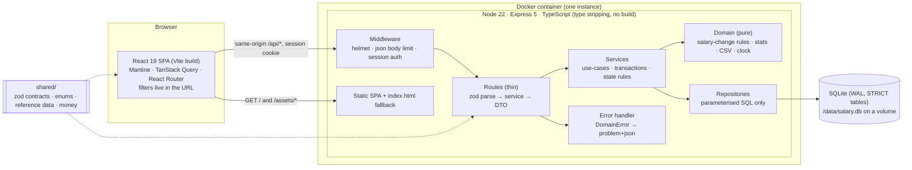
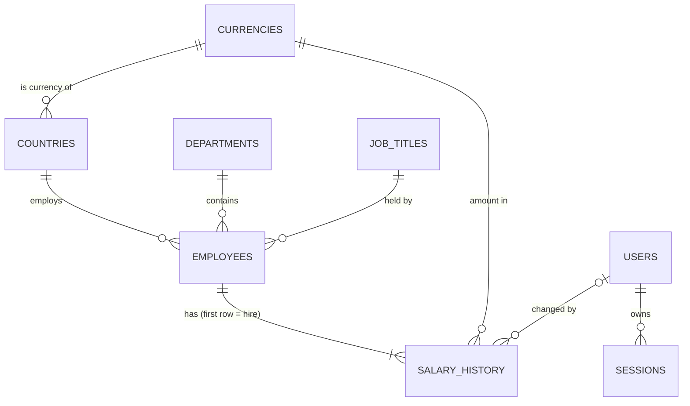

# Architecture

This document covers how v1 is built. The reasons behind each choice are in
[decisions.md](decisions.md), and the scope is in [requirements.md](requirements.md).

## 1. System overview

One deployable unit: a Node.js API that also serves the built React app. It uses a single
SQLite file on a persistent volume.



Why one container: there is one user and about 10,000 rows. Serving the SPA from the API
keeps everything same-origin, so there is no CORS and the cookie story stays simple. It
also gives one thing to deploy, monitor and explain.

## 2. Repository layout

npm workspaces, three packages:

```
api/      @salary/api     Express API, seed script; runs .ts directly on Node 22
  src/
    main.ts               composition root: config → db → migrate → sync reference data
                          → seed if empty → provision HR user → listen
    app.ts                buildApp(deps): the Express app, no listen(); used by tests
    config.ts             env vars validated with zod
    http/                 error handler, requireAuth, static SPA serving
    db/                   connection, migration runner, migrations/*.sql, reference sync
    domain/               pure functions: salary-change rules, stats, csv, clock
    auth/ employees/ insights/ export/
                          feature folders: routes.ts, service.ts, repository.ts (+ tests)
    seed/                 prng, catalogue, generate (pure), write, cli
web/      @salary/web     React + Vite + Mantine
  src/                    routes, features/{auth,employees,insights}, api client & hooks
shared/   @salary/shared  imported as TypeScript source by both api and web, no build
  src/                    zod contracts, enums, countries/currencies/FX snapshot, money
docs/                     requirements, decisions, architecture, plan, ai/
```

## 3. Layering rules

- **Routes** handle HTTP only. They parse input with a shared zod schema, call one service
  method and map the result to a DTO. They contain no SQL and no business rules.
- **Services** own each use-case and its transaction, for example `db.transaction(() => …)()`.
  They enforce rules that depend on stored data: the employee is active, the effective date
  is not before the latest change, and referenced ids exist. They throw typed
  `DomainError`s and know nothing about HTTP.
- **Domain** code is pure: no I/O, no framework imports. The clock and the random number
  generator are injected. This is where most unit tests live.
- **Repositories** hold the SQL, always parameterised. They map rows to camelCase objects
  and translate SQLite unique-constraint errors into `ConflictError`.
- **Dependencies are wired by hand** with factory functions; there is no DI container.
- **Never `await` inside a transaction.** better-sqlite3 transactions are synchronous, so
  inside one process no other request can interleave with a write. This is why v1
  needs no optimistic locking.

Validation happens in three layers:
1. **zod at the HTTP edge:** shape, types, ranges, real dates, and `.strict()` objects so
   unknown fields are rejected.
2. **Services:** rules that depend on stored state.
3. **Database:** STRICT types, NOT NULL, CHECK, UNIQUE and foreign keys, as the last line
   of defence.

## 4. Data model



```sql
-- Reference data. Countries and currencies are upserted at boot from shared/ (one source of truth).
CREATE TABLE currencies (
  code          TEXT PRIMARY KEY CHECK (length(code) = 3),       -- ISO 4217
  name          TEXT NOT NULL,
  minor_unit    INTEGER NOT NULL CHECK (minor_unit BETWEEN 0 AND 3), -- JPY 0, USD 2, KWD 3
  units_per_usd REAL NOT NULL CHECK (units_per_usd > 0),         -- static snapshot: 1 USD = x units
  rate_as_of    TEXT NOT NULL CHECK (rate_as_of IS date(rate_as_of))
) STRICT;

CREATE TABLE countries (
  code          TEXT PRIMARY KEY CHECK (length(code) = 2),       -- ISO 3166-1 alpha-2
  name          TEXT NOT NULL UNIQUE,
  currency_code TEXT NOT NULL REFERENCES currencies(code)
) STRICT;

CREATE TABLE departments (id INTEGER PRIMARY KEY, name TEXT NOT NULL UNIQUE COLLATE NOCASE) STRICT;
CREATE TABLE job_titles  (id INTEGER PRIMARY KEY, name TEXT NOT NULL UNIQUE COLLATE NOCASE) STRICT;

CREATE TABLE employees (
  id                   INTEGER PRIMARY KEY,
  employee_code        TEXT GENERATED ALWAYS AS (printf('EMP-%06d', id)) VIRTUAL,
  full_name            TEXT NOT NULL CHECK (length(full_name) BETWEEN 1 AND 150),
  email                TEXT NOT NULL UNIQUE COLLATE NOCASE,        -- lower-cased by the service
  job_title_id         INTEGER NOT NULL REFERENCES job_titles(id),
  department_id        INTEGER NOT NULL REFERENCES departments(id),
  country_code         TEXT NOT NULL REFERENCES countries(code),   -- fixed after creation in v1
  hire_date            TEXT NOT NULL CHECK (hire_date IS date(hire_date)),
  status               TEXT NOT NULL DEFAULT 'active' CHECK (status IN ('active', 'left')),
  left_on              TEXT CHECK (left_on IS NULL OR left_on IS date(left_on)),
  current_salary_minor INTEGER NOT NULL CHECK (current_salary_minor > 0), -- cache of latest history row
  created_at           TEXT NOT NULL,
  updated_at           TEXT NOT NULL,
  CHECK ((status = 'left') = (left_on IS NOT NULL)),
  CHECK (left_on IS NULL OR left_on >= hire_date)
) STRICT;

CREATE TABLE salary_history (                -- append-only: the code has no UPDATE or DELETE path
  id                 INTEGER PRIMARY KEY,
  employee_id        INTEGER NOT NULL REFERENCES employees(id),
  amount_minor       INTEGER NOT NULL CHECK (amount_minor > 0),
  currency_code      TEXT NOT NULL REFERENCES currencies(code),  -- snapshot, so history stays readable
  effective_date     TEXT NOT NULL CHECK (effective_date IS date(effective_date)),
  reason             TEXT NOT NULL CHECK (reason IN
                       ('hire','annual_review','promotion','market_adjustment','correction','other')),
  note               TEXT CHECK (note IS NULL OR length(note) <= 500),
  changed_by_user_id INTEGER REFERENCES users(id),                -- NULL for seed data
  created_at         TEXT NOT NULL
) STRICT;

CREATE TABLE users (
  id            INTEGER PRIMARY KEY,
  email         TEXT NOT NULL UNIQUE COLLATE NOCASE,
  display_name  TEXT NOT NULL,
  password_hash TEXT NOT NULL,              -- "scrypt$N$r$p$salt$hash"
  created_at    TEXT NOT NULL
) STRICT;

CREATE TABLE sessions (
  token_hash TEXT PRIMARY KEY,              -- SHA-256 of the cookie token; the raw token is never stored
  user_id    INTEGER NOT NULL REFERENCES users(id) ON DELETE CASCADE,
  expires_at INTEGER NOT NULL               -- epoch ms from the injected clock
) STRICT;

-- The ONLY place USD conversion is defined.
CREATE VIEW employee_salaries AS
SELECT e.*,
       co.currency_code,
       cu.minor_unit,
       e.current_salary_minor / (power(10, cu.minor_unit) * cu.units_per_usd) AS salary_usd
FROM employees e
JOIN countries  co ON co.code = e.country_code
JOIN currencies cu ON cu.code = co.currency_code;
```

Indexes are added when a measured query needs them, and each is recorded in the
performance notes. The starting set covers foreign-key lookups, `(country_code, status)`
and the default sort `(full_name COLLATE NOCASE, id)`.

Notes on the schema:
- **Date checks use `IS date(col)`, not `= date(col)`.** For malformed input such as
  `'banana'`, `date()` returns NULL, and a CHECK that evaluates to NULL passes. A repository
  test inserts a bad date and expects the constraint to fail.
- **Current salary is a cached column** kept next to the history (decision D5). The salary
  change and the history row are written in the same transaction. Effective dates must be
  on or after the latest change and no later than today, so the cache can never go stale.
- **There is no currency column on `employees`.** Currency is derived from the country,
  and country cannot change in v1. Each history row stores its own currency as a snapshot.

## 5. Money and exchange rates

- **Storage.** Money is always an integer in the currency's minor unit plus an ISO 4217
  code. INR 25,00,000.00 is stored as `250000000`. JPY 8,000,000 is stored as `8000000`,
  because JPY has no minor unit. STRICT INTEGER columns reject fractions.
- **API shape.** Amounts travel as `Money = { amountMinor: number, currency: string }`,
  both in requests and responses. The server derives the currency from the country, so
  requests only send `amountMinor`.
- **Parsing.** `parseMoney("25,00,000.50", minorUnit)` in `shared/` works on the string: it
  splits on `.` and rejects more decimal places than the currency allows. It never does
  float maths. For example, `Math.round(1.005 * 100)` gives `100`, not `101`.
- **Formatting.** `formatMoney(money)` uses `Intl.NumberFormat`, with the number of
  decimals taken from our currency table rather than from the browser's locale data.
- **One source for currency data.** Countries, currencies, their minor units and the
  exchange-rate snapshot (`unitsPerUsd`, `asOf`) live in `shared/src/reference.ts`.
  - The API copies them into the database at boot.
  - The web app imports them to format money.
  - The seed uses them to generate realistic local salaries.
- **Conversion happens only in the `employee_salaries` view.** The list's USD sort, every
  USD figure and the export all read `salary_usd` from there. No TypeScript code converts
  currencies, so two implementations cannot drift apart.
- **Rounding.** USD values are estimates, because the rates are a static approximation.
  They stay unrounded floats until the response mapper rounds them once to cents. Local
  averages and medians are rounded once to the minor unit. Converted values are never
  stored.
- **Limits.** JavaScript integers are exact up to 2^53, about 9×10^15. Per-currency sums
  for 10,000 employees stay far below that. If high-denomination currencies such as IDR
  are added at scale, sum queries switch to `safeIntegers()`.

## 6. Metric definitions

| Term | Definition |
|---|---|
| Population | Employees with `status = 'active'`. Insights always use this; it is not a parameter. |
| Salary | Current annual gross base pay (`current_salary_minor`) in the country's currency. |
| USD value | `salary_usd` from the view, using one static snapshot with its as-of date. |
| Min, max, average | SQL aggregates over the group. |
| Median, percentiles | Pure TypeScript with Excel `PERCENTILE.INC` semantics: linear interpolation at rank `(n−1)·p` over sorted values. The median is P50. HR can check the numbers in a spreadsheet, and tests use fixtures checked in one, e.g. `[1, 2, 10]`: P90 = 8.4. |
| Payroll cost | Σ USD value per group. This is the annual base run-rate, not cash paid: no proration, bonuses or employer costs. The UI label says so. |
| Average by job title | Across the org: the mean of the USD values, weighted by headcount. Within one country: the mean in local currency. Averaging country averages is avoided, because it would give a 3-person country the same weight as a 900-person one. |
| Distribution | One country at a time, in local currency. About 10 equal-width bins with rounded edges (1/2/5 × 10^k), the lower bound inclusive, empty bins included, plus P10/P25/P50/P75/P90. Countries are never mixed in one histogram. |

**When to show local currency or USD.** If every value in a figure has the same currency,
show local currency first and USD second. If a figure spans currencies, show USD only,
with the note "USD at fixed rates as of <date>". An individual employee always shows local
currency first.

## 7. REST API

All routes are under `/api` and use JSON. Every route needs a session except `health` and
`auth/login`. Responses carry `Cache-Control: no-store`.

| Method & path | Input | Success |
|---|---|---|
| `GET /health` | – | `200 {status, version}` (version = git SHA) |
| `POST /auth/login` | `{email, password}` | `200 {user}` and `Set-Cookie: sid` |
| `POST /auth/logout` | – | `204`, deletes the session and clears the cookie |
| `GET /auth/me` | – | `200 {user}` |
| `GET /reference-data` | – | `200 {departments, jobTitles}` (countries and currencies come from `shared/`) |
| `GET /employees` | `q, country, departmentId, jobTitleId, status=active\|left\|all, sort, page, pageSize` | `200 {items, page, pageSize, total, fx}` |
| `GET /employees/export.csv` | same filters and sort, no paging | `200 text/csv`, UTF-8 BOM, attachment |
| `POST /employees` | `{fullName, email, jobTitleId, departmentId, countryCode, hireDate, salaryMinor}` | `201 EmployeeDetail`; also writes the `hire` history row |
| `GET /employees/:id` | – | `200 EmployeeDetail` including `salaryHistory[]` (newest first, with % change) |
| `PATCH /employees/:id` | any of `{fullName, email, jobTitleId, departmentId}` | `200 EmployeeDetail` |
| `POST /employees/:id/salary-changes` | `{amountMinor, effectiveDate, reason, note?}` | `201 EmployeeDetail` |
| `POST /employees/:id/leave` | `{leftOn}` | `200 EmployeeDetail` |
| `GET /insights/by-country` | – | `200 {items:[{country, currency, headcount, min, median, avg, max, avgUsd, payrollUsd}], fx}` |
| `GET /insights/by-job-title` | `country?` | `200 {items:[{jobTitle, headcount, countries, avgUsd, local?:{min, avg, max}}], fx}` |
| `GET /insights/by-department` | `country?` | `200 {items:[{department, headcount, payrollUsd, avgUsd, share}], totalUsd, fx}` |
| `GET /insights/distribution` | `country` (required) | `200 {country, currency, headcount, percentiles, buckets:[{from, to, count}]}` |

- **List details.**
  - `sort` is a whitelisted key with an optional `-` prefix for descending:
    `name | employeeCode | hireDate | country | department | jobTitle | salaryUsd`.
  - The key maps to a fixed SQL fragment, so user input is never interpolated into SQL.
    An `id` tie-breaker keeps pages stable.
  - Sorting by salary uses the USD value, because comparing ¥8,500,000 with $120,000 by
    face value means nothing.
  - `pageSize` defaults to 25 and is at most 100.
  - `q` matches name, email or employee code. LIKE wildcards in the search term are escaped.
- **Route order.** `export.csv` is registered before `/:id`.

**Errors** use RFC 9457 `application/problem+json`, with a machine-readable `code` and a
field list for validation failures:

```json
{ "type": "about:blank", "title": "Validation failed", "status": 400,
  "code": "VALIDATION_FAILED", "errors": [{ "path": "email", "message": "Invalid email" }] }
```

| Status | `code` |
|---|---|
| 400 | `VALIDATION_FAILED`, `UNKNOWN_REFERENCE`, `EFFECTIVE_DATE_OUT_OF_RANGE` |
| 401 | `UNAUTHENTICATED`, `INVALID_CREDENTIALS` |
| 404 | `NOT_FOUND`: an unknown employee, or an unknown `/api/*` route. It is never the SPA fallback. |
| 409 | `EMAIL_TAKEN`, `EMPLOYEE_LEFT`, `SALARY_UNCHANGED`, `EFFECTIVE_DATE_BEFORE_LATEST_CHANGE` |
| 413 | `PAYLOAD_TOO_LARGE`, mapped from the body parser's own error type |
| 500 | `INTERNAL`: a generic message. The stack trace is logged, never returned. |

## 8. Business rules

| Action | Rules (enforced by the API, each with a test) |
|---|---|
| Create employee | Email is valid, stored lower-case and unique, including leavers. Referenced ids exist. `hireDate` is between 1950-01-01 and today. `salaryMinor` is a positive safe integer. The first history row is `hire`, effective on `hireDate`. |
| Edit employee | Only name, email, title and department can change. Country and hire date are fixed in v1. A leaver cannot be edited (`EMPLOYEE_LEFT`). |
| Salary change | The employee is active. The latest effective date ≤ `effectiveDate` ≤ today; the same day as the latest change is allowed, and the change recorded later wins. The amount differs from the current salary. The reason is one of `annual_review, promotion, market_adjustment, correction, other`, and `hire` is reserved for creation. A note is required when the reason is `other`. The history row and the cached current salary are written in one transaction. |
| Mark as left | `leftOn` is ≥ both the hire date and the latest salary change, and ≤ today. Leavers drop out of insights and out of the default list. |

**"Today"** is the calendar date in a configured IANA time zone (`APP_TIME_ZONE`), taken
from an injected clock. Tests pin the instant, so every date rule is deterministic.

## 9. Authentication

Assumption 4 says "basic authentication". This is read as a simple email-and-password login
for a single HR role, not HTTP Basic, which has no logout and uses the browser's own prompt.

- **Users table.** At boot, one HR user is created from `ADMIN_EMAIL` and `ADMIN_PASSWORD`
  if the table is empty. In production the app refuses to start without them. The user's
  id is recorded as `changed_by` on every salary change, which gives an audit trail.
- **Passwords.**
  - Hashed with async `crypto.scrypt` using N=2^15, r=8, p=3 and `maxmem` of 64 MiB, which
    is OWASP-equivalent strength within 32 MiB of memory.
  - The hash string records its own parameters, so they can be raised later.
  - Comparison uses `timingSafeEqual`.
  - Wrong email and wrong password get the same error.
- **Sessions.**
  - The token is 32 random bytes, sent in a cookie named `sid`. The cookie is `HttpOnly`,
    `SameSite=Lax`, `Path=/`, and `Secure` in production. Tests run on http and set
    `Secure` off.
  - Only the SHA-256 of the token is stored, so a copy of the database contains no usable
    sessions.
  - Sessions expire 8 hours after login. Logout deletes the row.
  - A new token is created at every login.
- **CSRF.**
  - The app is same-origin and CORS is off.
  - `SameSite=Lax` keeps the cookie off cross-site POSTs.
  - The API only accepts JSON bodies, which cross-site forms cannot send.
  - No GET request changes data.
- **Hardening deliberately deferred.** The demo credentials are published for reviewers,
  so the following would protect nothing in v1: login rate limiting, an Origin-header
  check, and structured log redaction. They are listed as next steps in
  [decisions.md](decisions.md).

## 10. Deployment

- **Host: Fly.io**, one Machine with a volume mounted at `/data`. Railway is the fallback.
  Render's free tier has no persistent disk, so it would wipe reviewers' edits.
- **Image.**
  - Every stage uses `node:22.22-bookworm-slim`, which is glibc-based and matches
    better-sqlite3's prebuilt binaries.
  - Install with `npm ci --ignore-scripts`, then build the web app with Vite.
  - The runtime stage gets production dependencies only. It keeps `shared/` at the same
    relative path, so the workspace symlink still resolves: Node will not strip types
    from files under `node_modules`.
  - An entrypoint runs `chown` on the root-owned volume, then drops to the `node` user.
- **Boot sequence.**
  1. Validate config.
  2. Open the database: WAL, `foreign_keys=ON`, `busy_timeout`.
  3. Run migrations (numbered `.sql` files, tracked with `PRAGMA user_version`).
  4. Sync reference data.
  5. Seed 10,000 employees if the database is empty.
  6. Create the HR user if there is none.
  7. Listen.
  8. On SIGTERM, close the server and then the database.
- **Health.** `GET /api/health` returns the git SHA and imports from `shared/`, so the
  first deploy proves type stripping through the symlink. CI builds and runs the image and
  calls `curl /api/health` before deploying. Fly checks the same endpoint.
- **Resetting demo data.** `fly ssh console -C "node api/src/seed/cli.ts --reset"`. There
  is deliberately no env flag for this, because a forgotten flag would wipe data on every
  restart.
- **Single instance.** SQLite has one writer, so there is exactly one Machine. The growth
  path is to scale up the Machine first, then move to Postgres (§11).

## 11. Performance considerations

**Targets.** p95 under 300 ms for list and insights on the deployed app with 10,000
employees, and seeding 10,000 employees in under 2 seconds.

**Early measurements.** These come from planning prototypes: in-memory SQLite in the
development container, not the final code. They will be re-measured on the real code
and on the deployed Machine, and recorded in `docs/performance.md`.

| Operation, 10k employees | Measured |
|---|---|
| Seed 10,000 employees + ~25,000 history rows in one transaction | ~0.3 s |
| By-country aggregates through the FX view | ~10–13 ms |
| Deepest offset page, sorted by USD salary | ~9–19 ms |
| Fetch all rows for the CSV export | ~23 ms |
| Median per country in TypeScript over sorted arrays | ~20 ms |

**At 10,000 rows:**
- Every query is a full scan or close to one, and it is still fast. No caching or
  precomputed aggregates are needed.
- The UI uses server-side paging, so there is no virtualised table.
- The UI keeps the previous page visible while the next one loads, and search waits
  300 ms after typing stops.

**Growth path** (what changes at about 1 million rows, where prototypes measured 1–6 s
per query):
1. A stored, indexed `salary_usd_cents` column, recomputed whenever the rates change.
2. Keyset pagination for deep pages.
3. FTS5 full-text search instead of `LIKE '%…%'`.
4. Pre-computed aggregates, or a cache invalidated on every write.
5. Heavy reads moved off the event loop, because better-sqlite3 is synchronous.
6. Postgres, once more than one instance or concurrent writers are needed. The
   repository layer keeps that migration contained.
