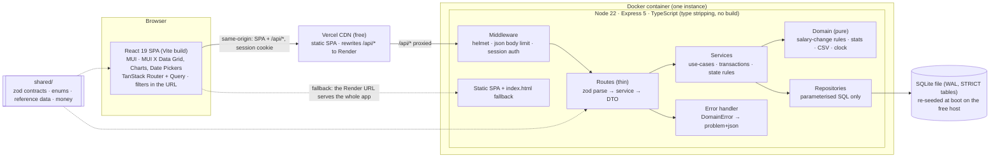
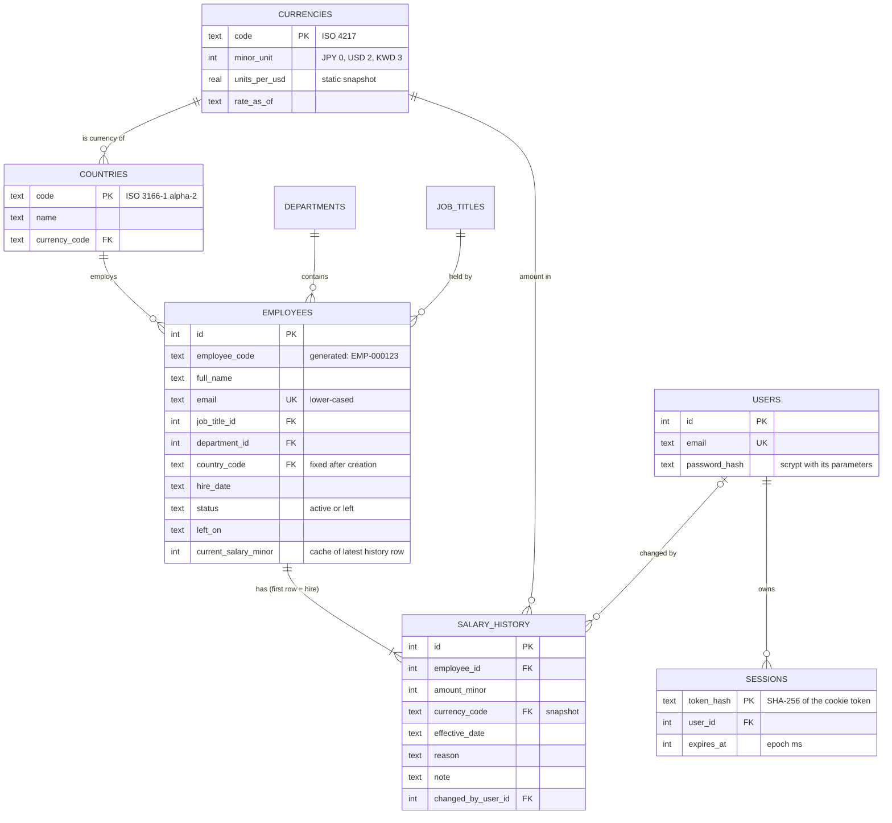

# Architecture

This document covers how v1 is built. The reasons behind each choice are in
[decisions.md](decisions.md), and the scope is in [requirements.md](requirements.md).

## 1. System overview

One deployable unit: a Node.js API that also serves the built React app. It uses a single
SQLite file. On the free host that file lives on temporary disk and is re-seeded at every
boot (§10). In production, Vercel's CDN serves the same SPA and proxies `/api/*` to the
container, so the browser sees one origin.



**Why one container:** there is one user and about 10,000 rows. The container serves both
the API and the SPA, so it works on its own and the image can be tested as one unit.

**Why Vercel in front:** the free Render instance sleeps. Vercel keeps the UI instantly
available, so the SPA can show its own "waking the server" state. Because Vercel proxies
`/api/*`, the browser still sees one origin: no CORS, and the cookie story stays simple
(§9, §10).

## 2. Repository layout

npm workspaces, three packages:

```
api/      @salary/api     Express API, seed script; runs .ts directly on Node 22
  src/
    main.ts               composition root: config → db → migrate → sync reference data
                          → seed if empty → provision HR user → listen
    app.ts                buildApp(deps): the Express app, no listen(); used by tests
    config.ts             env vars validated with zod
    http/                 error handler, requireAuth, static SPA serving
    db/                   connection, migration runner, migrations/*.sql, reference sync
    domain/               pure functions: salary-change rules, stats, csv, clock
    auth/ employees/ insights/ export/
                          feature folders: routes.ts, service.ts, repository.ts (+ tests)
    seed/                 prng, catalogue, generate (pure), write, cli
web/      @salary/web     React + Vite + MUI (Material UI, X Data Grid, X Charts, X Date Pickers)
  src/                    routes, features/{auth,employees,insights}, theme/, api client & hooks
  vercel.json             SPA hosting and the /api/* rewrite to Render
shared/   @salary/shared  imported as TypeScript source by both api and web, no build
  src/                    zod contracts, enums, countries/currencies/FX snapshot, money
docs/                     requirements, decisions, architecture, design system, plan, ai/
```

## 3. Layering rules

- **Routes** handle HTTP only. They parse input with a shared zod schema, call one service
  method and map the result to a DTO. They contain no SQL and no business rules.
- **Services** own each use-case and its transaction, for example `db.transaction(() => …)()`.
  They enforce rules that depend on stored data: the employee is active, the effective date
  is not before the latest change, and referenced ids exist. They throw typed
  `DomainError`s and know nothing about HTTP.
- **Domain** code is pure: no I/O, no framework imports. The clock and the random number
  generator are injected. This is where most unit tests live.
- **Repositories** hold the SQL, always parameterised. They map rows to camelCase objects
  and translate SQLite unique-constraint errors into `ConflictError`.
- **Dependencies are wired by hand** with factory functions; there is no DI container.
- **Never `await` inside a transaction.** better-sqlite3 transactions are synchronous, so
  inside one process no other request can interleave with a write. Concurrent requests
  therefore cannot corrupt data. They do not prevent a lost update from a stale form,
  such as two open tabs editing the same employee, where the last save wins. With a
  single HR user that is accepted in v1, so there is no optimistic locking.

Validation happens in three layers:
1. **zod at the HTTP edge:** shape, types, ranges, real dates, and `.strict()` request
   objects, so unknown fields are rejected. Response contracts in `shared/` are not
   strict: an open tab can be older than the API (§10), so fields a newer API adds are
   stripped rather than rejected.
2. **Services:** rules that depend on stored state.
3. **Database:** STRICT types, NOT NULL, CHECK, UNIQUE and foreign keys, as the last line
   of defence.

## 4. Data model

The migration in `api/src/db/migrations/` is the source of truth for the schema. This
section records the design and the constraints that matter.



`departments` and `job_titles` are plain `(id, name)` lists, with names unique regardless
of case. All tables are `STRICT`.

The single place where USD conversion is defined:

```sql
CREATE VIEW employee_salaries AS
SELECT e.*,
       co.currency_code,
       cu.minor_unit,
       e.current_salary_minor / (power(10, cu.minor_unit) * cu.units_per_usd) AS salary_usd
FROM employees e
JOIN countries  co ON co.code = e.country_code
JOIN currencies cu ON cu.code = co.currency_code;
```

Indexes are added when a measured query needs them, and each is recorded in the
performance notes. The starting set covers foreign-key lookups, `(country_code, status)`
and the default sort `(full_name COLLATE NOCASE, id)`.

Constraints that matter:
- **Positive amounts.** `current_salary_minor > 0` and `amount_minor > 0`. Status and
  `left_on` must agree: `(status = 'left') = (left_on IS NOT NULL)`, and
  `left_on >= hire_date`. The reason is checked against the fixed list.
- **Date checks use `IS date(col)`, not `= date(col)`.** For malformed input such as
  `'banana'`, `date()` returns NULL, and a CHECK that evaluates to NULL passes. A repository
  test inserts a bad date and expects the constraint to fail.
- **Current salary is a cached column** kept next to the history (decision D5). The salary
  change and the history row are written in the same transaction. Effective dates must be
  on or after the latest change and no later than today, so the cache can never go stale.
- **There is no currency column on `employees`.** Currency is derived from the country,
  and country cannot change in v1. Each history row stores its own currency as a snapshot.

## 5. Money and exchange rates

- **Storage.** Money is always an integer in the currency's minor unit plus an ISO 4217
  code. INR 25,00,000.00 is stored as `250000000`. JPY 8,000,000 is stored as `8000000`,
  because JPY has no minor unit. STRICT INTEGER columns reject fractions.
- **API shape.** Responses carry amounts as
  `Money = { amountMinor: number, currency: string }`. Requests send only the integer:
  `salaryMinor` when creating an employee, `amountMinor` for a salary change. The server
  derives the currency from the employee's country.
- **Parsing.** `parseMoney("25,00,000.50", minorUnit)` in `shared/` works on the string: it
  splits on `.` and rejects more decimal places than the currency allows. It never does
  float maths. For example, `Math.round(1.005 * 100)` gives `100`, not `101`.
- **Formatting.** `formatMoney(money)` uses `Intl.NumberFormat`, with the number of
  decimals taken from our currency table rather than from the browser's locale data.
- **One source for currency data.** Countries, currencies, their minor units and the
  exchange-rate snapshot (`unitsPerUsd`, `asOf`) live in `shared/src/reference.ts`.
  - The API copies them into the database at boot.
  - The web app imports them to format money.
  - The seed uses them to generate realistic local salaries.
- **Conversion happens only in the `employee_salaries` view.** The list's USD sort, every
  USD figure and the export all read `salary_usd` from there. No TypeScript code converts
  currencies, so two implementations cannot drift apart.
- **Rounding.** USD values are estimates, because the rates are a static approximation.
  They stay unrounded floats until the response mapper rounds them once to cents. Local
  averages and medians are rounded once to the minor unit. Converted values are never
  stored.
- **Limits.** JavaScript integers are exact up to 2^53, about 9×10^15. Per-currency sums
  for 10,000 employees stay far below that. If high-denomination currencies such as IDR
  are added at scale, sum queries switch to `safeIntegers()`.

## 6. Metrics: why these, and how they are defined

The starting set came from the clarifying questions, and the recruiter confirmed it.
Each metric answers a question the HR manager asks today with spreadsheets. Where the
set was refined, the reason is given.

| The HR manager asks | Metric | Refinement, and why |
|---|---|---|
| What is the lowest, highest and typical pay in a country? | Min, **median**, average and max by country, in local currency | Median added. Pay is right-skewed: a few senior salaries pull the average up, so the median is the honest "typical" figure. Showing both makes the skew visible. |
| How many people do we employ there, and what does base pay cost? | Headcount and payroll (USD) on the same by-country table | Added to the by-country view. It sizes each country and gives the org-wide total without another screen. |
| How spread out is pay in a country? | Distribution: a histogram plus P10–P90 | One country at a time. Mixing countries in one histogram mixes currencies and labour markets, so its shape would mean nothing. |
| What do we pay for a given job title? | Average by job title | Two levels. Within a country it is in local currency, which is the like-for-like comparison. Across the org it is in USD, weighted by headcount, and labelled as mixing labour markets. |
| Which department costs the most? | Payroll by department, in USD, with its share of the total | Shown as a share as well as an amount, because "Engineering is 41% of base payroll" answers the question directly. |

Deliberately not metrics in v1: pay equity (it needs sensitive data and controls for role
and level), trends over time, and comparison against pay bands (no band data exists). The
reasons are in [requirements.md](requirements.md).

**Definitions:**

| Term | Definition |
|---|---|
| Population | Employees with `status = 'active'`. Insights always use this; it is not a parameter. |
| Salary | Current annual gross base pay (`current_salary_minor`) in the country's currency. |
| USD value | `salary_usd` from the view, using one static snapshot with its as-of date. |
| Min, max, average | SQL aggregates over the group. |
| Median, percentiles | Pure TypeScript with Excel `PERCENTILE.INC` semantics: linear interpolation at rank `(n−1)·p` over sorted values. The median is P50. HR can check the numbers in a spreadsheet, and tests use fixtures checked in one, e.g. `[1, 2, 10]`: P90 = 8.4. |
| Payroll cost | Σ USD value per group. This is the annual base run-rate, not cash paid: no proration, bonuses or employer costs. The UI label says so. |
| Average by job title | Across the org: the mean of the USD values, weighted by headcount. Within one country: the mean in local currency. Averaging country averages is avoided, because it would give a 3-person country the same weight as a 900-person one. |
| Distribution | One country at a time, in local currency. About 10 equal-width bins with rounded edges (1/2/5 × 10^k), the lower bound inclusive, empty bins included, plus P10/P25/P50/P75/P90. Countries are never mixed in one histogram. |

**When to show local currency or USD.** If every value in a figure has the same currency,
show local currency first and USD second. If a figure spans currencies, show USD only,
with the note "USD at fixed rates as of <date>". An individual employee always shows local
currency first.

## 7. REST API

All routes are under `/api` and use JSON. Every route needs a session except `health` and
`auth/login`. Responses carry `Cache-Control: no-store`.

| Method & path | Input | Success |
|---|---|---|
| `GET /health` | – | `200 {status, version}` (version = git SHA) |
| `POST /auth/login` | `{email, password}` | `200 {user}` and `Set-Cookie: sid` |
| `POST /auth/logout` | – | `204`, deletes the session and clears the cookie |
| `GET /auth/me` | – | `200 {user}` |
| `GET /reference-data` | – | `200 {departments, jobTitles}` (countries and currencies come from `shared/`) |
| `GET /employees` | `q, country, departmentId, jobTitleId, status=active\|left\|all, sort, page, pageSize` | `200 {items, page, pageSize, total, fx}` |
| `GET /employees/export.csv` | same filters and sort, no paging | `200 text/csv`, UTF-8 BOM, attachment |
| `POST /employees` | `{fullName, email, jobTitleId, departmentId, countryCode, hireDate, salaryMinor}` | `201 EmployeeDetail`; also writes the `hire` history row |
| `GET /employees/:id` | – | `200 EmployeeDetail` including `salaryHistory[]` (newest first, with % change) |
| `PATCH /employees/:id` | any of `{fullName, email, jobTitleId, departmentId}` | `200 EmployeeDetail` |
| `POST /employees/:id/salary-changes` | `{amountMinor, effectiveDate, reason, note?}` | `201 EmployeeDetail` |
| `POST /employees/:id/leave` | `{leftOn}` | `200 EmployeeDetail` |
| `GET /insights/by-country` | – | `200 {items:[{country, currency, headcount, min, median, avg, max, avgUsd, payrollUsd}], fx}` |
| `GET /insights/by-job-title` | `country?` | `200 {items:[{jobTitle, headcount, countries, avgUsd, local?:{min, avg, max}}], fx}` |
| `GET /insights/by-department` | – | `200 {items:[{department, headcount, payrollUsd, avgUsd, share}], totalUsd, fx}` |
| `GET /insights/distribution` | `country` (required) | `200 {country, currency, headcount, percentiles, buckets:[{from, to, count}]}` |

- **List details.**
  - `sort` is a whitelisted key with an optional `-` prefix for descending:
    `name | employeeCode | hireDate | country | department | jobTitle | salaryUsd`.
  - The key maps to a fixed SQL fragment, so user input is never interpolated into SQL.
    An `id` tie-breaker keeps pages stable.
  - Sorting by salary uses the USD value, because comparing ¥8,500,000 with $120,000 by
    face value means nothing.
  - `pageSize` defaults to 25 and is at most 100.
  - `q` matches name, email or employee code. LIKE wildcards in the search term are escaped.
- **Route order.** `export.csv` is registered before `/:id`.

**Errors** use RFC 9457 `application/problem+json`, with a machine-readable `code` and a
field list for validation failures:

```json
{ "type": "about:blank", "title": "Validation failed", "status": 400,
  "code": "VALIDATION_FAILED", "errors": [{ "path": "email", "message": "Invalid email" }] }
```

| Status | `code` |
|---|---|
| 400 | `VALIDATION_FAILED`, `UNKNOWN_REFERENCE`, `DATE_OUT_OF_RANGE` (a `hireDate`, `effectiveDate` or `leftOn` outside its allowed range) |
| 401 | `UNAUTHENTICATED`, `INVALID_CREDENTIALS` |
| 404 | `NOT_FOUND`: an unknown employee, or an unknown `/api/*` route. It is never the SPA fallback. |
| 409 | `EMAIL_TAKEN`, `EMPLOYEE_LEFT`, `SALARY_UNCHANGED`, `EFFECTIVE_DATE_BEFORE_LATEST_CHANGE` |
| 413 / 415 | Errors raised by the body parser (`err.type` is set) keep their own status: too large → 413 `PAYLOAD_TOO_LARGE`; unsupported charset or encoding → 415; malformed JSON → 400 `VALIDATION_FAILED`. |
| 500 | `INTERNAL`: a generic message. The stack trace is logged, never returned. |

## 8. Business rules

| Action | Rules (enforced by the API, each with a test) |
|---|---|
| Create employee | Email is valid, stored lower-case and unique, including leavers. Referenced ids exist. `hireDate` is between 1950-01-01 and today. `salaryMinor` is a positive safe integer. The first history row is `hire`, effective on `hireDate`. |
| Edit employee | Only name, email, title and department can change. Country and hire date are fixed in v1. A leaver cannot be edited (`EMPLOYEE_LEFT`). |
| Salary change | The employee is active. The latest effective date ≤ `effectiveDate` ≤ today; the same day as the latest change is allowed, and the change recorded later wins. The amount differs from the current salary. The reason is one of `annual_review, promotion, market_adjustment, correction, other`, and `hire` is reserved for creation. A note is required when the reason is `other`. The history row and the cached current salary are written in one transaction. |
| Mark as left | `leftOn` is ≥ both the hire date and the latest salary change, and ≤ today. Leavers drop out of insights and out of the default list. |

**"Today"** is the calendar date in a configured IANA time zone (`APP_TIME_ZONE`), taken
from an injected clock. Tests pin the instant, so every date rule is deterministic.

## 9. Authentication

Assumption 4 says "basic authentication". This is read as a simple email-and-password login
for a single HR role, not HTTP Basic, which has no logout and uses the browser's own prompt.

- **Users table.** At boot, one HR user is created from `ADMIN_EMAIL` and `ADMIN_PASSWORD`
  if the table is empty. In production the app refuses to start without them. The user's
  id is recorded as `changed_by_user_id` on every salary change, which gives an audit trail.
- **Passwords.**
  - Hashed with async `crypto.scrypt` using N=2^15, r=8, p=3, one of OWASP's
    recommended settings. Each hash needs just over 32 MiB, so `maxmem` is set to 64 MiB:
    Node's 32 MiB default rejects these parameters.
  - The hash string records its own parameters, so they can be raised later.
  - Comparison uses `timingSafeEqual`.
  - On the free host's 0.1 CPU a hash takes a few seconds. That is accepted, because it
    happens once per login, and lowering the cost would drop below OWASP's minimum.
  - Wrong email and wrong password get the same error.
- **Sessions.**
  - The token is 32 random bytes, sent in a cookie named `sid`. The cookie is `HttpOnly`,
    `SameSite=Lax`, `Path=/`, and `Secure` in production.
  - `Secure` comes from config, not from `req.secure`, which depends on proxy settings.
    Tests run on http and set `Secure` off.
  - The cookie never sets `Domain`, so it stays host-only. That keeps it working behind
    Vercel's proxy, where the browser only ever sees the Vercel host.
  - Only the SHA-256 of the token is stored, so a copy of the database contains no usable
    sessions.
  - Sessions expire 8 hours after login. Logout deletes the row.
  - On the free host the sessions table is wiped with the rest of the file when the
    instance sleeps or redeploys. The user is then signed out, and the web app's
    redirect on 401 takes them to the login page.
  - A new token is created at every login.
- **CSRF.**
  - The app is same-origin and CORS is off.
  - `SameSite=Lax` keeps the cookie off cross-site POSTs.
  - The API only accepts JSON bodies, which cross-site forms cannot send.
  - No GET request changes data.
- **Hardening deferred for time.** Login rate limiting, an Origin-header check and
  structured log redaction would add little to a demo whose credentials are published.
  A real deployment holding ACME's salary data needs at least login rate limiting before
  go-live. See [decisions.md](decisions.md).

## 10. Deployment

- **Public URL: Vercel (Hobby, free).**
  - Vercel builds `web/`: the project's Root Directory is `web`, the install command is
    `npm ci`, and the output is `dist`. Pointing it at the repo root would turn files in
    `api/` into serverless functions *(verified with Vercel's own detector)*.
  - `web/vercel.json` rewrites `/api/:path*` to the Render service and everything else to
    `index.html`. It also sets `x-vercel-enable-rewrite-caching: 0` on `/api`, so user
    data is never cached. As a second guard, the API sends `Cache-Control: no-store`.
  - A proxied request fails after 120 s, which is longer than a wake. The SPA still
    polls `/api/health` with short timeouts rather than holding one request.
  - Pull requests get preview deployments of the UI, which call the production API.
- **API host: Render's free web service**, running our Docker image. It has 512 MB RAM and
  0.1 CPU, and sleeps after 15 minutes without traffic. The free tier has no persistent
  disk, so the SQLite file is temporary.
  - `render.yaml` sets: `runtime: docker`, `plan: free`, `branch: main`,
    `autoDeployTrigger: checksPass`, `healthCheckPath: /api/health`, and a build filter
    that ignores `docs/**`, so a docs-only merge doesn't redeploy and reset the data.
  - The Render URL serves the whole app too, as the fallback if the Vercel proxy ever
    misbehaves.
  - Every boot starts from an empty database and seeds it. Data resets whenever the
    instance sleeps or redeploys.
  - The login page and README say so. The seed is deterministic, so every reviewer sees
    the same data.
  - Upgrade paths if data must persist are listed in [decisions.md](decisions.md) (P3).
- **Image.**
  - Every stage uses `node:22.22.3-bookworm-slim`, which is glibc-based and matches
    better-sqlite3's prebuilt binaries.
  - Install with `npm ci --ignore-scripts`, then build the web app with Vite.
  - The runtime stage gets production dependencies only. It keeps `shared/` at the same
    relative path, so the workspace symlink still resolves: Node will not strip types
    from files under `node_modules`.
  - The process runs as the unprivileged `node` user, with a data directory created in the
    image and owned by that user.
- **Boot sequence.**
  1. Validate config.
  2. Open the database: WAL, `foreign_keys=ON`, `busy_timeout`.
  3. Run migrations (numbered `.sql` files, tracked with `PRAGMA user_version`).
  4. Sync reference data.
  5. Seed 10,000 employees if the database is empty. On the free host it always is.
  6. Create the HR user if there is none.
  7. Listen.
  8. On SIGTERM, close the server and then the database.
- **Waking up.** The SPA's `ServerWakeGate` polls `/api/health` every 3 s with a 15 s
  timeout per attempt. Render's HTML loading page, a 502 or a timeout all count as "still
  waking" (design-system.md §4).
  - **Fallback if wake plus boot is too slow.** If it exceeds about 90 s, measured on
    Render once the boot seed lands (S4), boot changes:
    - the server listens *before* seeding;
    - seeding runs in batches, one transaction per 500 employees, yielding with
      `await setImmediate()` between batches and never inside a transaction;
    - `/api/health` returns 503 until the seed is done.

    The batches matter because better-sqlite3 is synchronous, and Render's health check
    needs an answer within 5 s.
  - **The UI can be newer than the API.** The UI deploys about a minute after a merge,
    the API several minutes later, so API changes stay backward-compatible.
    - `shared/` exports a numeric `API_VERSION`, bumped only when the UI needs a newer
      API, and `/api/health` returns it.
    - In production builds only, a UI whose `API_VERSION` is ahead says the server is
      updating. Previews always call the production API, so they skip the check.
    - Commit SHAs are not compared, because a docs-only merge redeploys Vercel but not
      Render.
- **Health.** `GET /api/health` returns `API_VERSION`, the deployed commit (`RENDER_GIT_COMMIT`), and
  imports from `shared/`, so the first deploy proves type stripping through the symlink.
  CI builds and runs the image and calls `curl /api/health` on every pull request. Render
  checks the same endpoint.
- **Deploys.** Render deploys `main` automatically after its CI checks pass
  (`autoDeployTrigger: checksPass`). `main` only changes through pull requests that
  passed CI, enforced by a GitHub ruleset (decision P4).
- **Resetting data locally.** `npm run seed -- --reset`. There is deliberately no env
  flag for this, because a forgotten flag would wipe data on every restart.
- **Single instance.** SQLite has one writer, so there is exactly one instance. The growth
  path is a paid instance with a persistent disk, then Postgres (§11).

## 11. Performance considerations

**Targets.**
- p95 under 300 ms for list and insights on the deployed app with 10,000 employees,
  measured on a warm instance.
- Seeding 10,000 employees in under 2 seconds locally.

The free host's 0.1 CPU is the binding constraint. Cold start is Render's wake-up (up to
about a minute) plus our own boot, which seeds 10,000 employees and hashes the HR password
before it listens. The 2-second seed target is local only, so boot time on the deployed
instance is measured too. Measured numbers, from the real code and the deployed instance,
will be recorded in `docs/performance.md` (slices S2 and S10). If insights miss the
target, their responses are cached in memory and the cache is cleared on every write,
which is cheap with one process and one writer.

**At 10,000 rows:**
- Every query is a full scan or close to one, which is still cheap at this size. No
  precomputed aggregates are planned. Caching is only the fallback above, if deployed
  measurements miss the target.
- The directory uses server-side paging (the Data Grid in server mode), so the browser
  only ever holds one page of at most 100 rows.
- The heavy routes are lazy-loaded: the directory (Data Grid) and Insights (charts). In a
  probe, everything together was about 425 KB gzip, and React plus MUI core about 164 KB.
- The UI keeps the previous page visible while the next one loads, and search waits
  300 ms after typing stops.

**Growth path** (what changes at about 1 million rows):
1. A stored, indexed `salary_usd_cents` column, recomputed whenever the rates change.
2. Keyset pagination for deep pages.
3. FTS5 full-text search instead of `LIKE '%…%'`.
4. Pre-computed aggregates, or a cache invalidated on every write.
5. Heavy reads moved off the event loop, because better-sqlite3 is synchronous.
6. Postgres, once more than one instance or concurrent writers are needed. The
   repository layer keeps that migration contained.
